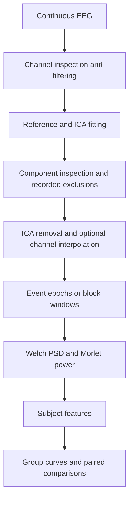

# EEG Study Workflow

EEG preprocessing and analysis workflow with human-in-the-loop artifact review and subject-to-group spectral analysis.

I use this workflow to keep recording preparation, ICA decisions and condition-level analysis in one repeatable sequence. It combines established MNE operations with configurable channels, event definitions, frequency bands and regions of interest. Each subject run saves its settings, review decisions and analysis outputs together.

## Workflow



Reference timing is configurable. The example configuration references before ICA and reapplies the reference after channel interpolation.

## Installation

Use Python 3.10 or later. Download this repository, open a terminal in its folder, and create a virtual environment:

```bash
python -m venv .venv
```

Activate it with `.venv\Scripts\Activate.ps1` on Windows PowerShell or `source .venv/bin/activate` on macOS/Linux, then install:

```bash
python -m pip install -e .
```

Optional dependencies can be installed separately:

```bash
python -m pip install -e ".[artifacts]"   # PyPREP, ICLabel and AutoReject
python -m pip install -e ".[xdf]"         # XDF input
python -m pip install -e ".[eeglab]"      # EEGLAB reader support
python -m pip install -e ".[notebooks]"   # JupyterLab
```

## Try the demo

```bash
eeg-workflow demo --output derivatives/demo-001
```

This generates 96 seconds of synthetic EEG with rhythms, blink-like pulses, a noisy channel and two labelled conditions, then runs preparation, ICA, epoching and analysis. **All demo outputs are labelled DEMONSTRATION ONLY.** The scripted exclusion uses the known generated blink trace; real recordings require a researcher to inspect components and record a decision.

Open `derivatives/demo-001/inspection/`, `ica_comparison.png`, `psd.png`, `tfr.png` and `subject_summary.json` to follow the processing. [Example figures](examples/demo_results/README.md) are included for a quick preview. The [ICA walkthrough](notebooks/01_ica_and_subject_walkthrough.ipynb) demonstrates the review step interactively.

## Use your own recordings

The command-line reader accepts BrainVision (`.vhdr` with its `.eeg`/`.vmrk` companions), FIF, EDF, BDF, EEGLAB and configured XDF inputs. For other formats, pass an MNE `Raw` object through the Python interface described in [configuration](docs/configuration.md).

Copy `configs/study.json` and set your channel names/types, montage, filter limits, reference, bad channels, event descriptions, conditions, ROIs and bands. The example assumes named 10–20 channels and two conditions; replace these definitions to match your recording. At least four EEG channels with usable electrode positions are required for this workflow's ICA inspection.

```bash
eeg-workflow prepare --input data/sub-001.vhdr --config configs/study.json --subject sub-001 --output derivatives/sub-001
```

Preparation stops after fitting ICA. Inspect `channel_qc.csv`, `manifest.json` and the component topographies, source traces and spectra in `inspection/`. The saved trace figure shows the first 15 seconds; inspect the full recording through MNE when deciding exclusions.

Record your final zero-based component indices, then continue:

```bash
eeg-workflow review --run derivatives/sub-001 --exclude 0,2 --reviewer "researcher" --reason "Blink and muscle activity confirmed from maps, traces and spectra"
eeg-workflow finish --run derivatives/sub-001
eeg-workflow analyse --run derivatives/sub-001
```

The indices above are illustrative. Use `--exclude none` when inspection supports retaining every component. `ica_review.json` records the reviewer, rationale, indices and hashes of the fitted data, model and configuration. A missing or mismatched decision prevents cleaning. Use a fresh run directory when changing settings or exclusions.

### Artifact review

I keep ICA exclusions explicit because component maps, activity and spectra need to be interpreted together. Optional ICLabel suggestions (`prepare --suggest-iclabel`) are advisory; they do not select the final exclusions. PyPREP bad-channel detection and AutoReject epoch repair/rejection are also optional. Review their reports and adjust the configuration before accepting a run.

### Epochs and analysis

Three epoching modes cover common experimental layouts: event-locked windows, fixed windows within duration-bearing annotations, and fixed windows within explicit labelled time intervals. `BAD` annotations exclude intersecting epochs. [Configuration examples](docs/configuration.md#epoching) show each mode.

Hierarchical markers are optional. Recorded descriptions such as `S1` and `S2` can map to flat condition names such as `A` and `B`. Labels such as `A/early` are useful when a recording has identifiable phases. For recordings without event markers, define time intervals explicitly, including a single interval for a continuous recording. Condition and phase meanings come from the recording protocol or timing records; the workflow does not infer them. See [recordings without markers](docs/configuration.md#recordings-without-markers).

Welch PSD is computed per epoch, then averaged within each condition and ROI. Feature tables contain mean band PSD, its natural log, mean band dB PSD, and frontal alpha asymmetry when left/right frontal alpha definitions are configured. Morlet analysis exports averaged linear power and a separate dB plot. Frequency ranges, channels and condition selections are explicit; time-frequency analysis can be disabled with an empty `morlet_conditions` list. See [methods and interpretation](docs/methods.md) for the exact definitions.

## Subject-to-group analysis

Repeat the subject workflow with unique IDs and consistent feature definitions. For a paired condition comparison:

```bash
eeg-workflow group --features derivatives/sub-001/features.csv derivatives/sub-002/features.csv --curves derivatives/sub-001/psd_curves.csv derivatives/sub-002/psd_curves.csv --condition-a A --condition-b B --metrics Frontal_Alpha_ln_mean_psd FAA --output derivatives/group
```

The output includes the combined feature table, subject trajectories, paired t-tests and Wilcoxon tests, plus mean/SEM PSD curves when `--curves` is provided. Pairs are matched by subject ID; incomplete pairs are reported. Participants are the unit of analysis. Choose metrics according to your analysis plan: reported p-values are unadjusted for multiple comparisons. A [group walkthrough](notebooks/02_subject_to_group_walkthrough.ipynb) uses synthetic subjects to demonstrate the interface.

## Files and outputs

```text
src/eeg_workflow/    Recording IO, preprocessing, ICA, epoching and analysis
configs/study.json  Editable configuration for your recordings
notebooks/          Subject review and group walkthroughs
docs/               Configuration guide and method definitions
examples/           Labelled synthetic output previews
tests/              Signal, review-persistence and subject-pairing checks
pyproject.toml      Dependencies and the eeg-workflow command
LICENSE             MIT license for reuse and modification
```

Each completed run contains prepared/cleaned FIF data, the fitted ICA model, cleaned epochs, review/configuration records, channel QC, PSD curves, feature tables, optional TFR arrays, figures and a subject summary. Keep recordings and generated derivatives outside version control; `data/` and `derivatives/` are ignored by default.

## Checks and limits

```bash
python -m unittest discover -s tests -v
```

The tests cover deterministic demo signals, filtering, event/block boundaries, PSD/TFR dimensions, ICA decision persistence and subject pairing. `requirements-tested.txt` records the scientific dependency versions used for local checks.

Filters, referencing, epoch duration and channel selection need to fit the recording and scientific question. Electrode positions and correct EEG units matter for inspection and interpolation. Short epochs limit low-frequency spectral estimates; wavelet edges and residual artifacts require review. The demo demonstrates execution and file handling, without establishing physiological validity or a condition effect.

The code is available under the [MIT license](LICENSE).
