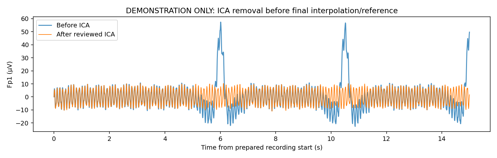
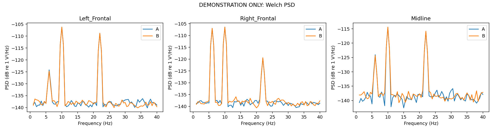
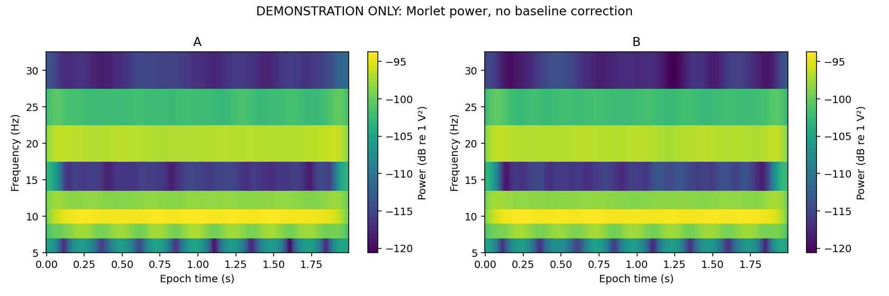

# Synthetic output previews

**DEMONSTRATION ONLY.** These figures and CSV tables come from the deterministic synthetic run with seed 97. They show output formats and processing steps, without physiological findings.

Run `eeg-workflow demo --output derivatives/demo-001` from the repository root to generate the full recording, ICA model, decision record, epochs, arrays and summaries locally.

`features.csv` contains subject/condition feature rows. `psd_curves.csv` contains frequency-wise ROI estimates. Both tables label every row as demonstration data.
